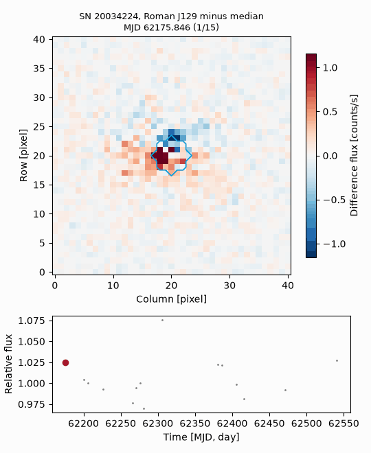
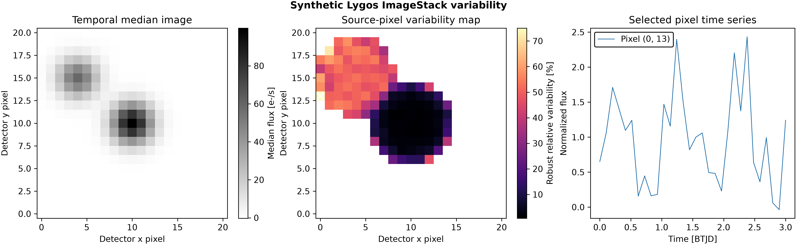
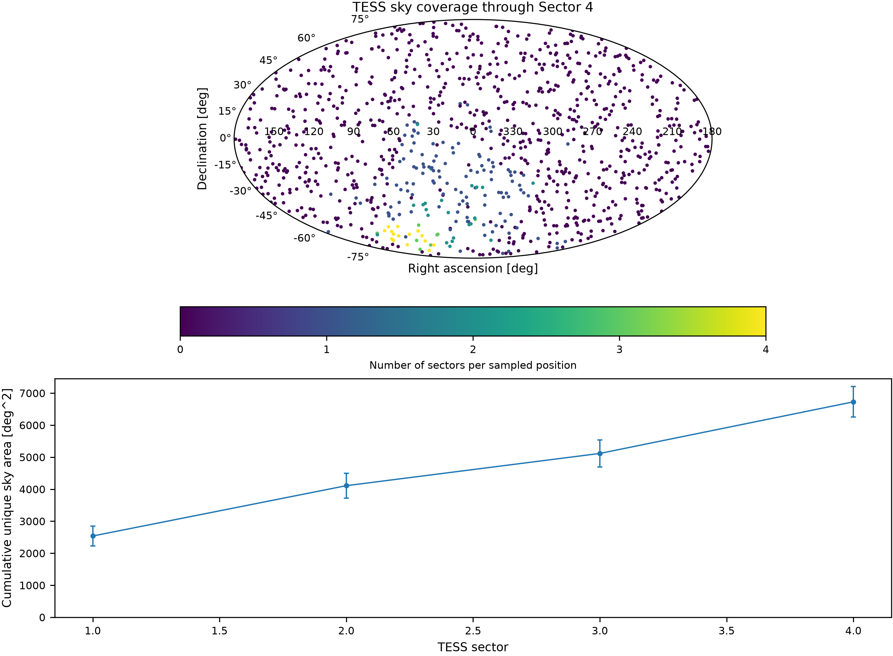
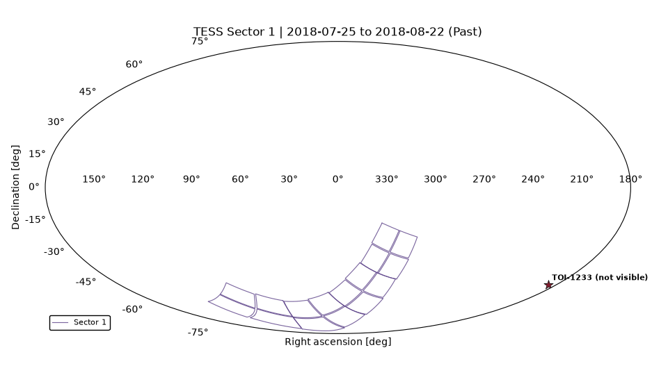
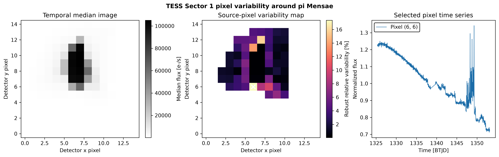
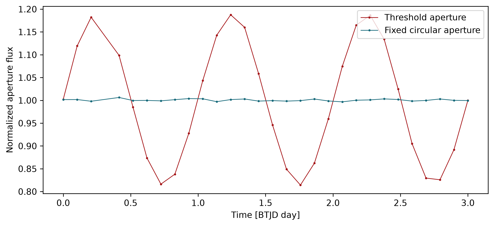
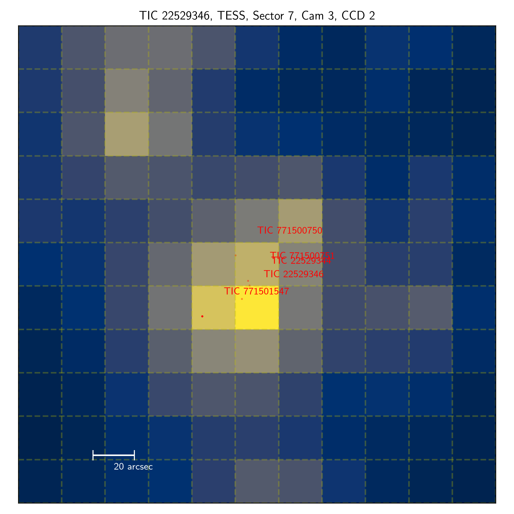

# Lygos

## Purpose
I start with the pixels when I want to understand where a light curve came from. Lygos retrieves image time series from the Transiting Exoplanet Survey Satellite (TESS) and the Nancy Grace Roman Space Telescope, then extracts TESS light curves with image-based photometry. A neighboring star can contribute flux to a target's aperture, so I want to know who is sharing the pixels. Documentation is at https://lygos.readthedocs.io, with its source in `docs/`.

Pliny records Lygos as an earlier name for Byzantium in [*Natural History* 4.11](https://en.wikisource.org/wiki/Natural_History_(Rackham,_Jones,_%26_Eichholz)/Book_4). The name's deeper etymology is uncertain. I use it here for a pipeline that traces light curves back to the image pixels that produced them.

Run `python -m pytest -q` from the checkout to execute the tests. The project
uses pytest's importlib mode by default, allowing test directories from multiple
checkouts to be collected together even when test filenames match.

## Images from TESS and Roman
Every retrieval returns one `ImageStack`, a time-ordered cube of images with times, uncertainties, quality flags, and sky coordinates. Background subtraction, difference imaging, variability maps, apertures, aperture photometry, centroids, plots, and animations therefore work the same way for every product.

| Product | Source | Function |
| --- | --- | --- |
| TESS cutouts | MAST TESSCut | `get_tess_cutout` |
| TESS full-frame images | public MAST bucket on Amazon Web Services | `get_tess_ffi`, `get_tess_ffi_cutout` |
| Roman detector images | OpenUniverse 2024 simulation at IRSA | `read_roman_image` |
| Roman cutout time series | OpenUniverse 2024 simulation at IRSA | `get_roman_cutout` |

No archive account is needed, and only the pixels a cutout needs are transferred.

```python
import lygos

stack = lygos.get_tess_cutout("RR Lyr", sector=14, size=15)[0].good()
aperture = stack.threshold_aperture(threshold=5.0)
lygos.animate_stack(stack.select(slice(0, 120)), "rrlyr", aperture=aperture,
                    light_curve=stack.select(slice(0, 120)).aperture_photometry(aperture))

column, row = stack.pixel_of(lygos.resolve_coordinate("RR Lyr"))
vertices = [(column - 4, row - 3), (column + 3, row - 3), (column + 4, row + 1),
            (column + 2, row + 4), (column - 4, row + 3)]
custom_aperture = stack.polygon_aperture(vertices)
custom_light_curve = stack.aperture_photometry(custom_aperture)

roman = lygos.get_roman_cutout((9.6632, -43.88128), band="J129", size=41, mjd_range=(62150, 62550))
lygos.animate_stack(roman.subtract_background(), "supernova", difference=True)
```



Examples in `examples/tess_cutout_time_series/`, `examples/tess_full_frame_images/`, and `examples/roman_time_domain_supernova/` use only public data.

The [synthetic ImageStack notebook](examples/synthetic_image_stack.ipynb) creates
a small toy scene and demonstrates background subtraction, threshold and fixed
apertures, aperture photometry, and relative-variability plotting. It uses no
archive data and writes its static and optional Bokeh outputs under
`examples/visuals/`.



## TESS sector coverage

Lygos can estimate the cumulative unique sky area covered by ordered TESS sectors. It samples the celestial sphere uniformly, tests each sample against the mission's CCD WCS geometry, and plots the accumulated area with its Monte Carlo uncertainty. The example also writes a dated sector-footprint animation, with TOI-1233 highlighted.

The estimate covers nominal detector footprints. It does not measure usable exposure time or data quality. Runtime scales with the number of sky samples and sectors. The default 1,024 samples keep the estimate quick, and larger samples reduce Monte Carlo uncertainty.

```bash
python examples/tess_sector_coverage/tess_sector_coverage.py --sectors 1 2 3 4 --animation-sectors 1 2 3 4
```





## ULTRASAT synthetic images

The `examples/ultrasat_synthetic/ultrasat_synthetic.py` example runs Lygos's
image simulator for any target name resolvable by MAST and present in the TIC.
It assumes 2-arcsec pixels, a 200-second cadence, a 160-second exposure, and the
ULTRASAT near-ultraviolet band (230-290 nm). The pixel, cadence, exposure, and
count-rate choices are illustrative settings in this workflow. It writes a median image and an
aperture light curve under the example's `visuals/` directory.

Set `LYGOS_PATH` before running the example so the simulated image cube and
catalog cache go under the Lygos data directory:

```bash
export LYGOS_PATH=/path/to/lygos
python examples/ultrasat_synthetic/ultrasat_synthetic.py --target Vega
```

This deterministic expected-count-rate simulation uses TIC Tmag with Lygos's
ULTRASAT zeropoint. It does not convert a measured ultraviolet spectrum or add
shot and read noise. The example exercises Lygos's image workflow and does not
forecast ULTRASAT observations.

The mission's [current observing modes](https://www.weizmann.ac.il/ultrasat/science-mission/modes-of-operation/modes-of-operation)
specify continuous 300-second exposures for the high-cadence survey. Predicting
mission data requires a UV spectral conversion, a measured response and PSF,
and detector-noise modeling in addition to the existing image workflow.

## Mauve data status

Mauve's published science product is stellar UV-visible spectrophotometry over
200-700 nm. The mission uses a telescope coupled to spectrometers. Selected
commissioning spectra and calibration information are offered as FITS files
through a Stardrive account, as described at `https://bssl.space/mauve/` and
`https://bssl.space/mauve/preview-data/`.

Lygos has no validated Mauve image reader or imaging example. A spectral detector
array cannot be interpreted as a calibrated sky image without a documented
mapping and response. The existing synthetic ImageStack examples make no Mauve
instrument claim. Calibrated spectral time series need a verified product schema,
wavelength and time conventions, and uncertainty treatment before a mission-specific
Miletos analysis can be demonstrated.

## Pixel-level variability

`ImageStack.variability_map()` measures scatter relative to the pixel uncertainties when available. `ImageStack.relative_variability_map()` instead reports robust scatter as a percentage of each pixel's median flux. The public Sector 1 example plots the median image, relative variability, and the most variable source pixel's light curve.

```bash
python examples/tess_pixel_variability/tess_pixel_variability.py
python examples/tess_pixel_variability/tess_pixel_variability.py --bokeh
```

Install `python -m pip install -e '.[bokeh]'` to write the interactive variability maps and pixel light curve as standalone HTML.



## Synthetic ImageStack workflow

The [synthetic ImageStack notebook](examples/synthetic_image_stack.ipynb)
builds a two-source image time series, compares threshold and fixed apertures,
and plots the pixel-level variability summary. Poisson counts are generated
from an explicit exposure time and converted to electron rates and
uncertainties. These are toy data, not a TESS observation.




[Interactive variability summary](examples/visuals/lygos_synthetic_variability_summary.html)

## Image-based photometry
I use the target-pixel images to model or extract stellar flux, assess nearby-source contamination, and retain a light curve I can trace back to the aperture or image model.

For PSF fitting, Lygos evaluates the image likelihood and delegates posterior inference to PCAT. PCAT is a required dependency, and the dependency map marks this direct image-inference path.

## Installation

```bash
cd /path/to/lygos
pip install -e .
export LYGOS_PATH=/path/to/lygos
```

`LYGOS_PATH` identifies the repository root. Runtime data and downloaded mission caches belong under its ignored `data/` directory, while generated figures belong under its ignored `visuals/` directory. Functions accept explicit paths when a workflow needs an isolated run directory.

## Public TESS target-pixel example

With `LYGOS_PATH` set to the repository root, run:

```bash
python examples/public_tess_target_pixel.py --typefileplot png
```



The example queries the public Mikulski Archive for Space Telescopes (MAST) for the WASP-121 SPOC target-pixel products, selects TESS Sector 7, masks nonzero quality flags, and calculates the median 11 by 11 pixel count map with nearby TESS Input Catalog sources overlaid. The figure contains observed TESS data rather than a simulation and quantifies the image-level contamination context. This example does not extract a light curve.

## Following the photometry
For a target analysis, I want to inspect:

- input image or target metadata
- extracted or modeled source apertures
- intermediate photometric comparisons
- final target light curves and summary plots.

Lygos writes these products under the configured data and visualization directories.
